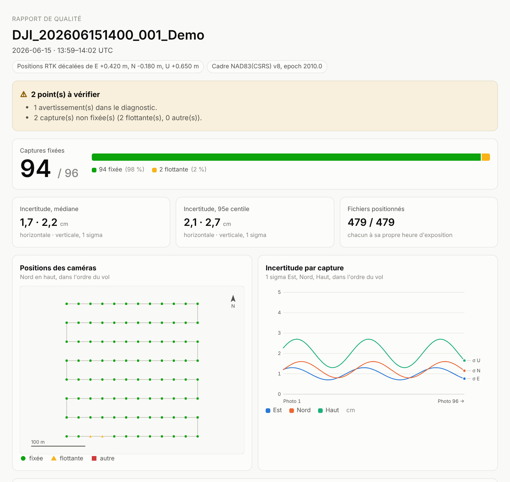

<div align="center">

# Azimut

**Géoréférencement PPK libre pour les drones de levé DJI**

Des positions de caméra précises pour la photogrammétrie, de la carte SD jusqu'à PIX4D,
Metashape et OpenDroneMap, avec le Mavic 3M multispectral traité fichier par fichier.

[](https://github.com/tofunori/azimut/actions/workflows/ci.yml)
[](LICENSE)


[English](README.md) · [Installation](docs/install.md) · [Validation](docs/validation.md)

</div>

---

Azimut lit le dossier d'un vol DJI, le vérifie, calcule une solution cinématique
post-traitée (PPK) contre une station de base avec
[RTKLIB-EX](https://github.com/rtklibexplorer/RTKLIB), puis écrit la position de la caméra
pour chaque image, avec son incertitude, son cadre de référence et, sur demande, sa hauteur
CGVD2013. C'est une solution libre de remplacement aux outils fermés, souvent réservés à
Windows, habituellement utilisés pour cette étape. Il est conçu pour la recherche : chaque
règle est rattachée à une source publique et rien n'est approximé en silence. Développé au
GlacioLab de l'Université du Québec à Trois-Rivières (UQTR).

<p align="center">
  
  <br><sub>Le rapport de qualité produit pour chaque vol (vol de démonstration synthétique ; thème clair ou sombre, en français ou en anglais).</sub>
</p>

## Ce qu'il fait

| | |
|---|---|
| **Diagnostic avant traitement** | Inventaire d'une carte SD ou d'une campagne entière en quelques secondes, à partir des seuls en-têtes d'images : captures Mavic 3M incomplètes, appariement photos–MRK, taux de fix en temps réel, couverture de la station de base, intervalle et distance. |
| **PPK** | Journal GNSS brut du drone et RINEX de la base → solution combinée RTKLIB-EX → antenne interpolée à l'heure d'exposition de chaque fichier → centre de la caméra avec le bras de levier DJI. |
| **Mavic 3M, fichier par fichier** | Les quatre bandes TIFF sont exposées 26 ms après le JPEG RVB ; chaque fichier reçoit sa propre position (jusqu'à 26 cm d'écart à 10 m/s). |
| **Correction RTK** | Pour les vols RTK, décalage de toutes les positions selon la correction de la base, par exemple une solution **CSRS-PPP** de RNCan. |
| **Hauteurs** | Hauteurs ellipsoïdales dans le cadre indiqué, et hauteurs orthométriques CGVD2013 par le géoïde CGG2013a de RNCan, avec vérification que la grille correspond au cadre. |
| **Sorties** | CSV pour Metashape et PIX4D, fichier de géolocalisation PIX4Dmatic, `geo.txt` d'OpenDroneMap, liste des problèmes et **rapport de qualité** HTML/JSON. |
| **Dans les images** | Sur demande, écriture des positions dans l'EXIF et le XMP DJI, sur place (annulable) ou dans des copies, sans rien changer d'autre, pas même les métadonnées radiométriques du Mavic 3M. |
| **Agents** | `azimut mcp` permet à Claude Code ou Codex de mener tout le traitement en posant les questions à l'utilisateur à chaque décision, au lieu de deviner. |

## Validation

Vérifié de bout en bout sur un vol **Mavic 3M** complet (450 captures, 2 248 fichiers, sans
RTK) contre une station IGS à 7,6 km : **450 captures sur 450 fixées**, 95,6 % des époques de
la trajectoire fixées, incertitude médiane à 1 sigma de 0,4 cm en horizontal et 0,5 cm en
vertical (estimation de RTKLIB), environ deux minutes de calcul à partir de 295 Mo
d'en-têtes pour un vol de 22 Go. Les hauteurs CGVD2013 concordent avec PROJ à 0,05 mm près.
L'écriture dans les images ne modifie que les octets enregistrés, et l'annulation redonne
des fichiers identiques.

**Pas encore démontré :** la précision absolue, par comparaison avec des points de contrôle
au sol et avec un autre logiciel sur les mêmes vols. Voir
[docs/validation.md](docs/validation.md) (en anglais) pour le détail et la suite.

## Démarrage rapide

```sh
# 1. Installer (Rust 1.82+), ou télécharger un exécutable dans les Releases
cargo install --path crates/azimut-cli

# 2. Essayer sur un vol synthétique
azimut demo demo/DJI_Demo --captures 96 --survey
azimut shift demo --enu 0.42,-0.18,0.65 --frame "NAD83(CSRS) v8, epoch 2010.0" \
    --out demo/out --report-lang fr

# 3. Sur des données réelles : diagnostic, puis traitement contre une base
azimut scan /chemin/campagne --base /chemin/base.24o
azimut process /chemin/campagne \
    --base /chemin/base.24o --base-ppp /chemin/12345678.sum --antex igs20.atx \
    --geoid ca_nrc_CGG2013an83.tif --rtklib /chemin/rtklib/bin \
    --report-lang fr --out resultats
```

| Fichier | Contenu |
|---|---|
| `<vol>_report.html` | Rapport de qualité : points à vérifier, taux de fix, incertitudes, carte, base, diagnostic, chaque capture. |
| `<vol>_positions.csv` | Une ligne par fichier image : position, incertitude E/N/H, état du fix, cadre, hauteur CGVD2013. |
| `<vol>_pix4dmatic.csv` | Import de géolocalisation PIX4Dmatic, avec `<vol>_pix4dmatic.txt` qui explique l'import. |
| `<vol>_geo.txt` | Positions, angles et précisions pour OpenDroneMap. |
| `<vol>_problems.csv` | Captures sans position ou sans incertitude, et pourquoi. |
| `<vol>_solution.json` | Tout le résultat, pour les programmes ; utilisé par `azimut write-images`. |

La documentation détaillée est en anglais : voir le [README anglais](README.md#documentation).

## Citer

Pour citer Azimut dans un travail de recherche, utilisez [CITATION.cff](CITATION.cff)
(bouton « Cite this repository » de GitHub), et citez RTKLIB-EX pour le moteur GNSS.

## Licence

BSD 2-Clause, compatible avec RTKLIB-EX. Voir [LICENSE](LICENSE).
