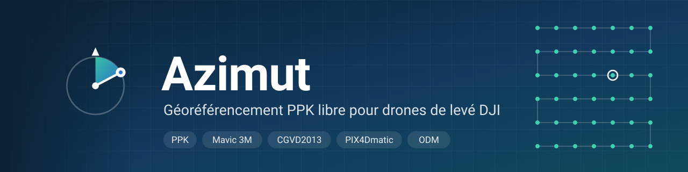
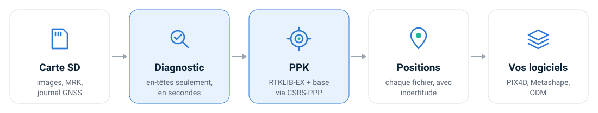

<p align="center">
  
</p>

<p align="center">
  <a href="https://github.com/tofunori/azimut/actions/workflows/ci.yml"></a>
  <a href="https://github.com/tofunori/azimut/releases"></a>
  <a href="LICENSE"></a>
  
</p>

<p align="center">
  <b><a href="README.md">English</a></b> ·
  <a href="docs/guide-labo.md">Guide du labo</a> ·
  <a href="https://tofunori.github.io/azimut/">Site web</a> ·
  <a href="#installer">Installer</a> ·
  <a href="examples">Exemples</a> ·
  <a href="docs/validation.md">Validation</a>
</p>

**Azimut** transforme le dossier d'un vol DJI et une station de base en positions de caméra
précises pour la photogrammétrie : vérifiées, post-traitées (PPK), avec incertitudes, cadre de
référence et hauteurs CGVD2013, prêtes pour PIX4D, Metashape et OpenDroneMap. Logiciel libre,
conçu pour la recherche au GlacioLab (UQTR).

<p align="center">
  
</p>

## Installer

<table>
<tr><th>Windows (PowerShell)</th><th>macOS · Linux (Terminal)</th></tr>
<tr>
<td>

```powershell
irm https://raw.githubusercontent.com/tofunori/azimut/main/scripts/install.ps1 | iex
```

</td>
<td>

```sh
curl -fsSL https://raw.githubusercontent.com/tofunori/azimut/main/scripts/install.sh | sh
```

</td>
</tr>
</table>

RTKLIB-EX, le moteur GNSS, est inclus. On peut aussi télécharger une archive dans les
[Releases](https://github.com/tofunori/azimut/releases). Pas à pas : le
[guide du labo](docs/guide-labo.md).

## Utiliser

```sh
azimut scan    vols/ --base base.24o                                                     # vérifier, en secondes
azimut process vols/ --base base.24o --base-ppp base.sum --report-lang fr --out resultats  # PPK + rapport
azimut process vols/ --base base.24o --submit-ppp --email vous@labo.ca --report-lang fr --out resultats  # base soumise à CSRS-PPP, puis PPK
```

<p align="center">
  <a href="examples"></a>
  <br><sub>Chaque vol reçoit un rapport de qualité. <a href="examples">Voir les exemples de sorties →</a></sub>
</p>

## Fonctions

| | |
|:--|:--|
| 🔎 **Diagnostic d'abord** | Des cartes SD entières en secondes, par les seuls en-têtes : bandes manquantes, appariement MRK, couverture de la base. |
| 🛰️ **PPK** | RTKLIB-EX contre votre base, chaque fichier positionné à sa propre heure d'exposition. |
| 🌈 **Mavic 3M** | Cinq fichiers par capture ; les bandes, exposées 26 ms après l'image RVB, ont leur propre position. |
| 📍 **CSRS-PPP et RTK** | Position de la base par CSRS-PPP (RNCan), soumise par Azimut ou lue d'un rapport ; vols RTK corrigés du décalage de la base. |
| 📏 **Hauteurs** | Ellipsoïdales ou CGVD2013, en vérifiant que le géoïde correspond au cadre. |
| 📤 **Sorties** | PIX4Dmatic, Metashape, OpenDroneMap, CSV, et un rapport HTML/JSON. |
| 🖼️ **Dans les images** | Positions dans l'EXIF et le XMP DJI, sur place (annulable) ou dans des copies, radiométrie intacte. |
| 🤖 **Agents** | `azimut mcp` : Claude ou Codex mènent le traitement et vous consultent à chaque décision. |

## Validation

| | |
|:--|:--|
| ✅ Vol Mavic 3M complet, 450 captures, PPK contre une station IGS | **450 / 450 fixées**, incertitude médiane 0,4 cm H · 0,5 cm V |
| ✅ Hauteurs CGVD2013 | Identiques à PROJ à 0,05 mm près |
| ✅ Écriture dans les images | Seuls les octets de position changent ; l'annulation redonne des fichiers identiques |
| ⏳ Précision absolue | Points de contrôle au sol et comparaison avec un autre logiciel à venir |

Détails : [docs/validation.md](docs/validation.md) (en anglais).

## Citer, contribuer, licence

Citer avec [CITATION.cff](CITATION.cff) (« Cite this repository »), et citer
[RTKLIB-EX](https://github.com/rtklibexplorer/RTKLIB) pour le moteur GNSS. Contributions
bienvenues ([CONTRIBUTING.md](CONTRIBUTING.md)). Licence BSD 2-Clause ([LICENSE](LICENSE)).
La documentation détaillée est en anglais : voir le [README anglais](README.md#documentation).
