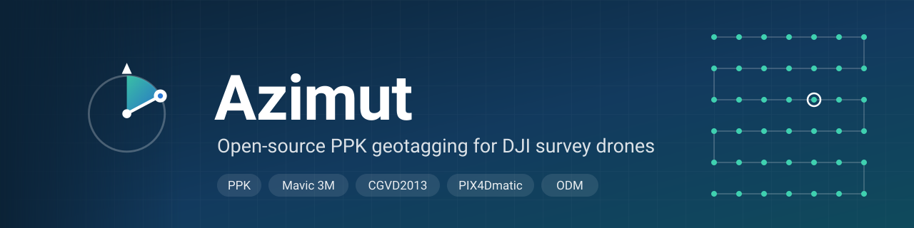
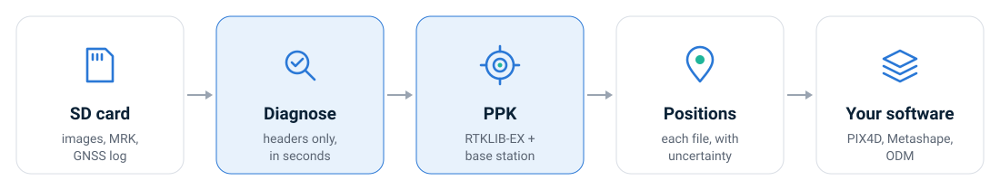
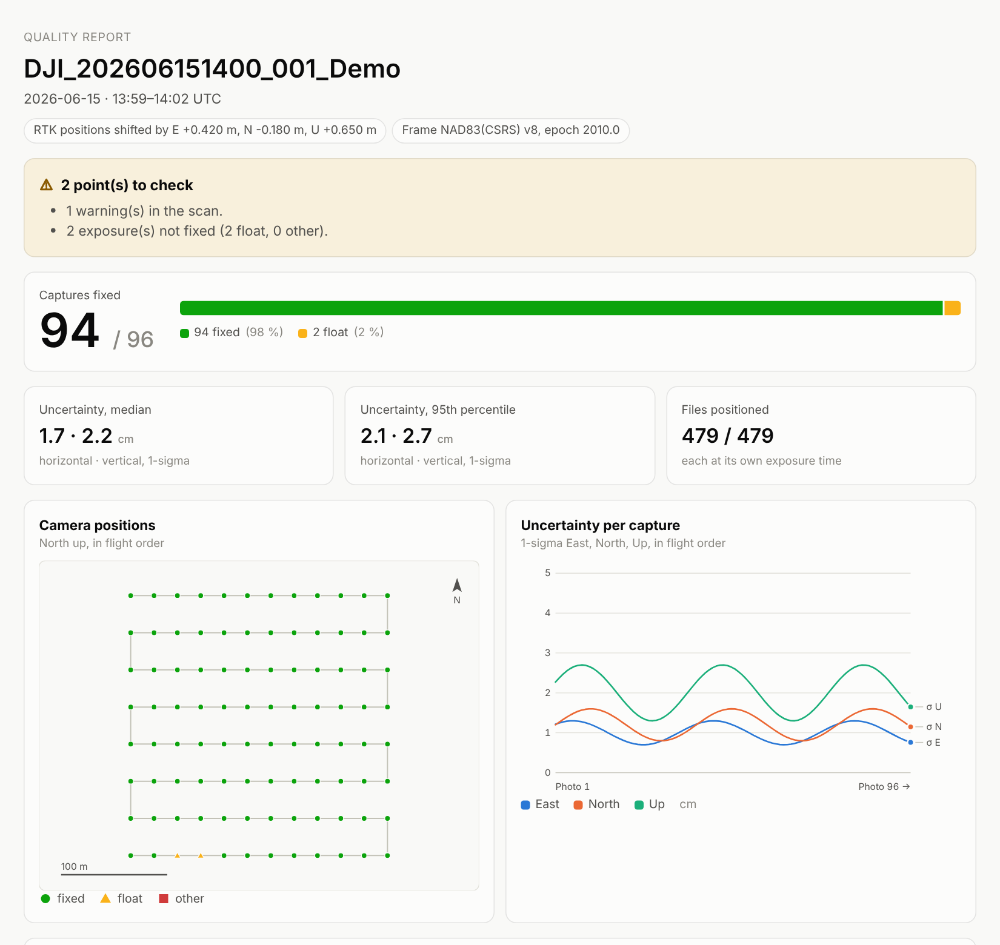

<p align="center">
  
</p>

<p align="center">
  <a href="https://github.com/tofunori/azimut/actions/workflows/ci.yml"></a>
  <a href="https://github.com/tofunori/azimut/releases"></a>
  <a href="LICENSE"></a>
  
</p>

<p align="center">
  <b><a href="README.fr.md">Français</a></b> ·
  <a href="docs/guide-labo.md">Guide du labo</a> ·
  <a href="#install">Install</a> ·
  <a href="examples">Example outputs</a> ·
  <a href="docs/validation.md">Validation</a> ·
  <a href="#documentation">Docs</a>
</p>

**Azimut** turns a DJI flight folder and a base station into precise camera positions for
photogrammetry: checked, post-processed (PPK), with uncertainties, reference frame and
CGVD2013 heights, ready for PIX4D, Metashape and OpenDroneMap. Open source, built for research
at the GlacioLab (UQTR).

<p align="center">
  
</p>

## Install

<table>
<tr><th>Windows (PowerShell)</th><th>macOS · Linux (Terminal)</th></tr>
<tr>
<td>

```powershell
irm https://raw.githubusercontent.com/tofunori/azimut/main/scripts/install.ps1 | iex
```

</td>
<td>

```sh
curl -fsSL https://raw.githubusercontent.com/tofunori/azimut/main/scripts/install.sh | sh
```

</td>
</tr>
</table>

RTKLIB-EX, the GNSS engine, comes with it. Or download an archive from the
[releases](https://github.com/tofunori/azimut/releases), or [build from source](docs/install.md).

## Use

```sh
azimut scan    flights/ --base base.24o                                   # check, in seconds
azimut process flights/ --base base.24o --base-ppp base.sum --out results  # PPK + report
```

<p align="center">
  <a href="examples"></a>
  <br><sub>Every flight gets a quality report (English or French). <a href="examples">See the example outputs →</a></sub>
</p>

## Features

| | |
|:--|:--|
| 🔎 **Diagnose first** | Whole SD cards in seconds, from image headers only: missing bands, MRK pairing, base coverage. |
| 🛰️ **PPK** | RTKLIB-EX against your base, each file positioned at its own exposure time. |
| 🌈 **Mavic 3M** | Five files per capture; the bands, exposed 26 ms after the RGB image, get their own position. |
| 📍 **CSRS-PPP & RTK** | Base position from NRCan CSRS-PPP; RTK flights corrected by the base shift. |
| 📏 **Heights** | Ellipsoidal or CGVD2013, with a check that the geoid matches the frame. |
| 📤 **Outputs** | PIX4Dmatic, Metashape, OpenDroneMap, CSV, and an HTML/JSON report. |
| 🖼️ **Into the images** | EXIF + DJI XMP positions, in place (undoable) or into copies, radiometry untouched. |
| 🤖 **Agents** | `azimut mcp`: Claude or Codex run the workflow and ask you at each decision. |

## Validation

| | |
|:--|:--|
| ✅ Full Mavic 3M flight, 450 captures, PPK against an IGS station | **450 / 450 fixed**, median 1-sigma 0.4 cm H · 0.5 cm V |
| ✅ CGVD2013 heights | Match PROJ within 0.05 mm |
| ✅ Writing into images | Only position bytes change; undo gives identical files |
| ⏳ Absolute accuracy | Ground checkpoints and comparison with another tool to come |

Details and what remains: [docs/validation.md](docs/validation.md).

## Documentation

| Start | Process | Outputs | More |
|:--|:--|:--|:--|
| [Install](docs/install.md) | [PPK & CSRS-PPP](docs/ppk.md) | [PIX4Dmatic](docs/pix4dmatic.md) | [Agents (MCP)](docs/mcp.md) |
| [Lab guide (FR)](docs/guide-labo.md) | [RTK flights](docs/rtk-shift.md) | [Into the images](docs/images.md) | [Architecture](docs/architecture.md) |
| [What `scan` checks](docs/scan.md) | [CGVD2013 heights](docs/heights.md) | [Example outputs](examples) | [Sources](SOURCES.md) · [Changelog](CHANGELOG.md) |

## Citing, contributing, license

Cite with [CITATION.cff](CITATION.cff) ("Cite this repository"), and cite
[RTKLIB-EX](https://github.com/rtklibexplorer/RTKLIB) for the GNSS engine. Contributions are
welcome ([CONTRIBUTING.md](CONTRIBUTING.md)): every format rule cites a public source.
BSD 2-Clause ([LICENSE](LICENSE)). Built on RTKLIB-EX, [PROJ](https://proj.org) grids from
NRCan's CGG2013a, [IGS](https://igs.org) antenna models and
[Nevada Geodetic Laboratory](https://geodesy.unr.edu) station positions.
