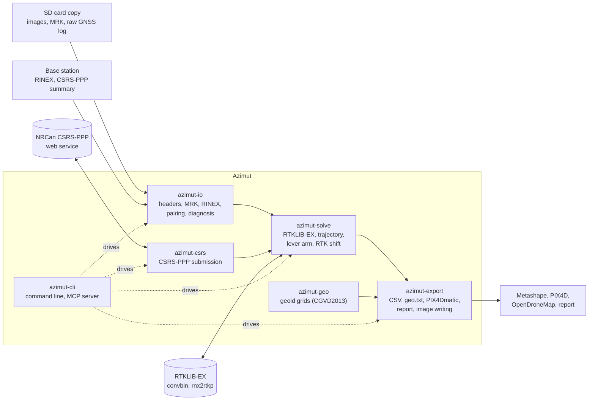

# Architecture

Azimut is a Rust workspace of six crates. Each one can be used as a library; the command-line
program and the MCP server only orchestrate them.

| Crate | Role |
|---|---|
| `azimut-io` | Header-only readers (JPEG APP1, TIFF tag 700, EXIF GPS layout), DJI MRK, RINEX summaries, CSRS-PPP summaries, Mavic 3M capture grouping, time pairing, folder diagnosis. Never reads pixels. |
| `azimut-solve` | RTKLIB-EX `convbin` and `rnx2rtkp`, RTKLIB solutions with full covariance, antenna interpolation to each file's exposure time, MRK lever arm, RTK shift. |
| `azimut-geo` | Geoid grids in the PROJ GeoTIFF format, orthometric heights, frame check. |
| `azimut-csrs` | Submission of the base RINEX to NRCan CSRS-PPP, wait and download of the results; the only crate that touches the network, and the only place that knows the service's undocumented interface. |
| `azimut-export` | Positions CSV, OpenDroneMap `geo.txt`, PIX4Dmatic geolocation, problems list, quality report (JSON and HTML), in-place or copy writing into images with undo. |
| `azimut-cli` | The `azimut` command and the `azimut mcp` server. |

## Design rules

- **Headers only.** Metadata is read from JPEG APP1 segments and TIFF tag 700. Pixels are
  never read, so a 22 GB multispectral flight is scanned from a few hundred megabytes.
- **Images are read-only by default.** Positions go to external files. `--write-images`
  changes only the position fields, in place or in copies, and saves the original bytes.
- **Pair on time, never on file order.** MRK GPS week and time of week are matched to XMP
  `UTCAtExposure`; whether that field holds GPS time or UTC is decided from the data.
- **Read by meaning, not by position.** MRK values are read by their suffix (`,N`, `,Lat`,
  `,Q`...), bands by XMP `BandName`, captures by `CaptureUUID`.
- **No silent approximations.** Reference frame, epoch and height type travel with every
  coordinate; a geoid grid for another frame is refused; an uncertainty RTKLIB could not give
  is left empty, never written as 0.
- **Every rule has a public source.** See [SOURCES.md](../SOURCES.md). No closed-source code,
  output or interface text is used.

## Tests

`cargo test --all --all-features` runs about 90 tests on synthetic DJI files built from public
documentation (`azimut_io::synthetic`, `azimut_geo::synthetic`), stand-in RTKLIB programs, and
the MCP server driven as an agent would. CI runs them with `rustfmt` and `clippy` on Linux,
macOS and Windows.

---
[Back to the README](../README.md)
