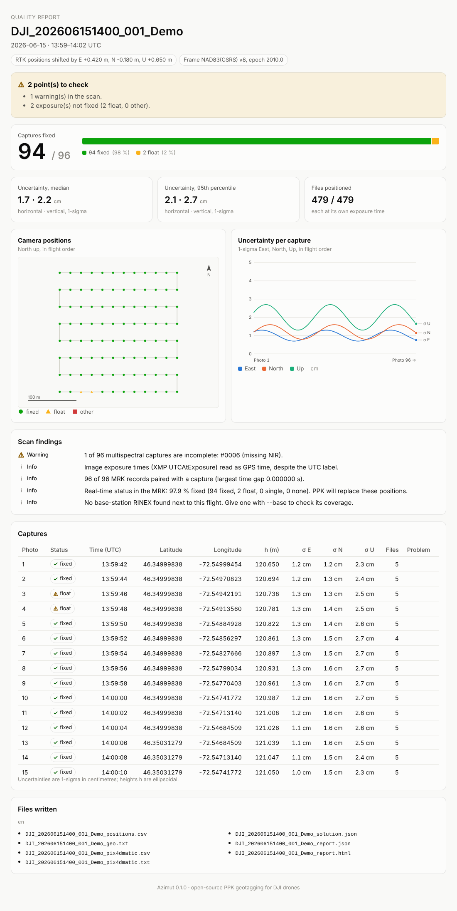
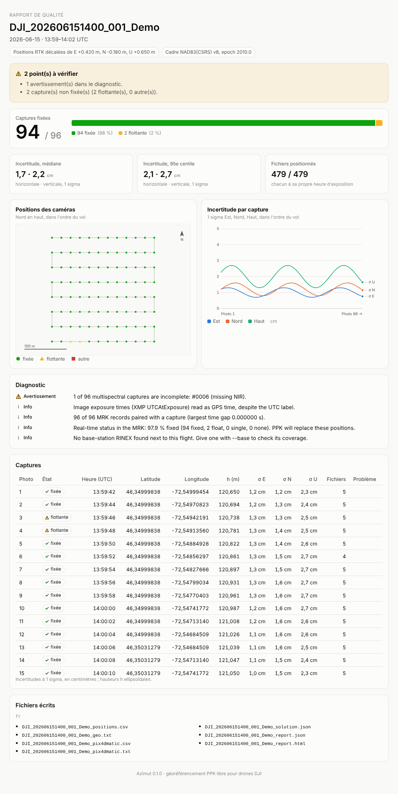

# Example outputs

Everything Azimut writes for one flight, from a **synthetic** Mavic 3M survey (96 captures,
480 files, generated with `azimut demo --survey`). No real survey data is in this folder.

```sh
azimut demo DJI_202606151400_001_Demo --captures 96 --survey
azimut shift DJI_202606151400_001_Demo --enu 0.42,-0.18,0.65 \
    --frame "NAD83(CSRS) v8, epoch 2010.0" --out out --report-lang fr
```

| File | What it is |
|---|---|
| [`report-en.html`](demo-flight/report-en.html), [`rapport-fr.html`](demo-flight/rapport-fr.html) | Quality report (download and open in a browser; screenshots below) |
| [`…_positions.csv`](demo-flight/DJI_202606151400_001_Demo_positions.csv) | One row per image file: position, 1-sigma E/N/U, status, frame |
| [`…_pix4dmatic.csv`](demo-flight/DJI_202606151400_001_Demo_pix4dmatic.csv) + [`.txt`](demo-flight/DJI_202606151400_001_Demo_pix4dmatic.txt) | PIX4Dmatic geolocation import and how to use it |
| [`…_geo.txt`](demo-flight/DJI_202606151400_001_Demo_geo.txt) | OpenDroneMap image positions |
| [`…_report.json`](demo-flight/DJI_202606151400_001_Demo_report.json) | The report's data, for programs and agents |

## The quality report

<table>
<tr><th>English</th><th>Français</th></tr>
<tr>
<td></td>
<td></td>
</tr>
</table>
